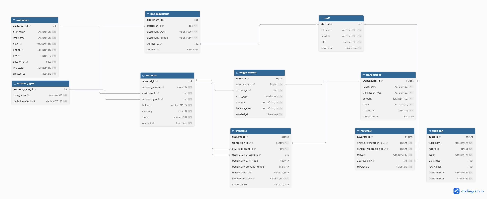

# Portfolio 1: Database Design and Modelling

**Case study:** NairaFlow Digital Bank – see [case-study.md](case-study.md) 
**DBMS:** PostgreSQL 18 (managed with pgAdmin 4)

## Contents

| File | Purpose |
| --- | --- |
| [case-study.md](case-study.md) | Organisation, users, data and key operations |
| [er-diagram.png](er-diagram.png) | Entity-relationship diagram (10 tables) |
| [er-diagram.dbml](er-diagram.dbml) | Source of the ER diagram (dbdiagram.io) |
| [schema.sql](schema.sql) | Tables, primary/foreign keys and constraints |
| [seed.sql](seed.sql) | Synthetic test data: 1,000 customers, 2,000 accounts, 502,000 transactions |
| [audit-triggers.sql](audit-triggers.sql) | Audit trail and append-only ledger protection |
| [normalisation.md](normalisation.md) | Normalisation from unnormalised form to BCNF, and design decisions |
| [screenshots/](screenshots/) | Evidence of each step |

## ER diagram

## How to run

1. Create a PostgreSQL database named `nairaflow`.
2. Run the scripts in this order in pgAdmin's Query Tool:
   1. `schema.sql` – builds empty tables (re-running it resets everything)
   2. `seed.sql` – loads test data (took about 4 minutes on my laptop)
   3. `audit-triggers.sql` – enables the audit trail and ledger protection

## Evidence

| Screenshot | What it shows |
| --- | --- |
| `01-tables-created.png` | All 10 tables created |
| `02-check-constraint-blocked.png` | Invalid account type rejected by a CHECK constraint |
| `03-row-counts.png` | Row counts after seeding |
| `04-balance-audit-clean.png` | Reconciliation: every stored balance matches its ledger (0 mismatches) |
| `05-audit-log-captured.png` | Account status change recorded in `audit_log` with old and new values |
| `06-ledger-tamper-blocked.png` | Attempt to edit a ledger entry blocked by trigger |

## Key design decisions

- **Double-entry ledger:** every successful money movement writes matching DEBIT and CREDIT rows.
- **Cached balance with reconciliation:** `accounts.balance` is stored for speed and audited against the ledger.
- **Idempotency key:** prevents a retried transfer request from being processed twice.
- **Either/or transfer destination:** internal account *or* external bank, enforced by a CHECK constraint.
- **Append-only ledger and audit trail:** history cannot be edited, and every change is recorded.

Full reasoning: [normalisation.md](normalisation.md).